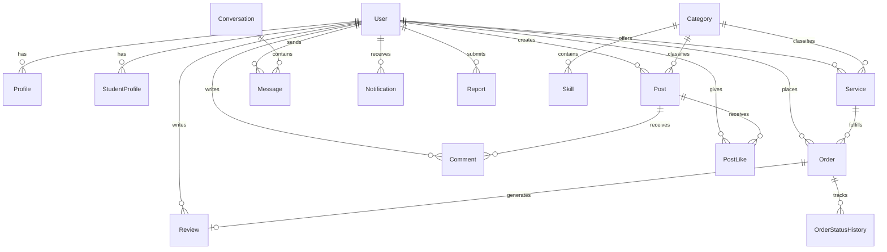

# SkillConnect: Complete Software Engineering Project Documentation
### A Full-Stack Student-Focused Social Marketplace & Portfolio Platform

---

## 1. Executive Summary

**Project Name**: SkillConnect  
**Project Type**: Full-Stack Web Application  
**Target Domain**: College / University Campus Freelancing & Talent Showcase  
**Technology Stack**:
* **Backend**: Python 3.13, Django 5.2 (MVC/MVT Architecture)
* **Database**: MySQL Server 8.0 (Relational schema with InnoDB engine and foreign keys)
* **Frontend**: HTML5, Modern Responsive CSS3 (CSS Variables, Flexbox, Grid), Vanilla JavaScript (ES6+, zero third-party frameworks like React/Vue/Node)
* **Authentication**: Django Authentication System with PBKDF2-SHA256 password hashing
* **File & Media Storage**: Django Media Storage system for user photo uploads

---

## 2. Problem Statement & Motivation

### The Problem
College students possess exceptional creative, artistic, and technical skills—such as portrait photography, festival poster design, wedding/festive mehndi, party makeup, Python coding, and academic tutoring. However:
1. **Commercial Platforms are Hostile to Students**: Traditional freelancing platforms (Upwork, Fiverr) are oversaturated, charge high commissions (up to 20%), require established agency experience, and are not accessible for quick campus gigs.
2. **Campus Clients Lack Discovery**: Fellow students, university clubs, fest committees, and local clients struggle to find affordable, trusted student creators within their campus community.
3. **Lack of Verifiable Credentials**: Informal WhatsApp or Instagram deals often lack accountability, milestone tracking, and authentic college identity verification.

### The SkillConnect Solution
SkillConnect combines:
1. **Social Portfolio Platform**: Students showcase their work through visual posts that peers can like, comment on, and share.
2. **Student Identity Verification**: Campus admins verify college ID cards to award an official **Verified Student** badge.
3. **Service Marketplace**: Transparent pricing in Indian Rupees (₹) with clear delivery timelines.
4. **Direct Communication**: Real-time one-to-one messaging with live AJAX polling.
5. **Order Tracking System**: A visual 5-step milestone tracking stepper with audit history and verified customer reviews.

---

## 3. User Roles & Personas

```text
                                  ┌───────────────────────────┐
                                  │   SkillConnect Platform   │
                                  └─────────────┬─────────────┘
                                                │
                ┌───────────────────────────────┼───────────────────────────────┐
                ▼                               ▼                               ▼
       ┌─────────────────┐             ┌─────────────────┐             ┌─────────────────┐
       │    Customer     │             │     Student     │             │  Administrator  │
       │ (Hires Talent)  │             │   (Offers Work) │             │ (Moderates All) │
       └─────────────────┘             └─────────────────┘             └─────────────────┘
```

### Role A: Customer
* Explores student talent through the **Personalized Recommended Feed**.
* Filters services by category, pricing, and ratings.
* Requests/books student services with custom requirements.
* Chats directly with student providers.
* Tracks milestone progress through the visual order tracking stepper.
* Leaves star ratings (1–5) and written reviews upon completion.

### Role B: Student / Service Provider
* Registers with college credentials (University name, roll number, course, year).
* Submits college ID card for administrator review.
* Earns the official **Verified Student** badge (`✓ Verified Student`).
* Publishes portfolio posts with images, captions, and skill tags.
* Sets up service packages with pricing in INR (₹) and estimated turnaround times.
* Manages incoming orders: Accepts/Rejects, updates status (`In Progress` &rarr; `Ready`).
* Builds a verified on-campus client history and earnings record.

### Role C: Platform Administrator
* Monitors real-time platform health via the **Admin Dashboard** (KPI metrics).
* Reviews pending student verification requests with ID card document previews.
* Moderates reported users, posts, comments, and services.
* Suspends or blocks offending accounts with one click.
* Manages categories and skill tags.

---

## 4. System Architecture & Design

### 4.1 Django MVT (Model-View-Template) Design Pattern

```text
[Client Web Browser]
       │  ▲
       │  │ (HTML / CSS / Vanilla JS)
       ▼  │
[Django URL Router (urls.py)]
       │
       ▼
[Django Views (views.py) - Controller Logic]
       │                 │
       ▼                 ▼
[Django Models (models.py)]   [Django Templates (*.html)]
       │
       ▼
[MySQL Database (skillconnect_db)]
```

1. **URL Dispatcher (`urls.py`)**: Maps HTTP paths to the appropriate view function.
2. **View (`views.py`)**: Executes business rules, enforces role-based access decorators (`@login_required`, `@admin_required`), queries models, and formats context dictionaries.
3. **Model (`models.py`)**: Maps Python object classes directly into relational MySQL tables using the Django Object-Relational Mapper (ORM).
4. **Template (`*.html`)**: Merges data with clean HTML markup and CSS layout.

---

## 5. Database Schema & Relational Design

The database is implemented in **MySQL 8.0** (`skillconnect_db`) with full referential integrity and foreign keys:



### Table Dictionary

| Table Name | Model | Primary Key | Key Foreign Keys | Purpose |
| :--- | :--- | :--- | :--- | :--- |
| `accounts_user` | `User` | `id` | None | Stores credentials, email, password hash, and role (`CUSTOMER`, `STUDENT`, `ADMIN`). |
| `accounts_profile` | `Profile` | `id` | `user_id` &rarr; `accounts_user` | User bio, phone number, and avatar image. |
| `accounts_studentprofile` | `StudentProfile` | `id` | `user_id` &rarr; `accounts_user` | College name, student ID, course, year, ID card upload, verification status. |
| `accounts_category` | `Category` | `id` | None | Skill domains (Photography, Graphic Design, Web Development, etc.). |
| `accounts_skill` | `Skill` | `id` | `category_id` &rarr; `accounts_category` | Specific skill tags (e.g. Fest Poster Design, Lightroom, Python). |
| `accounts_follow` | `Follow` | `id` | `follower_id`, `following_id` | Follower-following social graph between users. |
| `posts_post` | `Post` | `id` | `student_id`, `category_id` | Student portfolio images, captions, tags, and timestamps. |
| `posts_postlike` | `PostLike` | `id` | `post_id`, `user_id` | Records likes with `(post_id, user_id)` unique constraint. |
| `posts_comment` | `Comment` | `id` | `post_id`, `user_id` | User comments on portfolio posts. |
| `services_service` | `Service` | `id` | `student_id`, `category_id` | Service title, description, price (₹), and delivery days. |
| `orders_order` | `Order` | `id` | `customer_id`, `student_id`, `service_id` | Booking requirements, agreed price, and status state machine. |
| `orders_orderstatushistory`| `OrderStatusHistory`| `id` | `order_id`, `changed_by_id` | Complete timestamped audit trail of milestone changes. |
| `chat_conversation` | `Conversation` | `id` | `participant1_id`, `participant2_id` | One-to-one conversation thread between two users. |
| `chat_message` | `Message` | `id` | `conversation_id`, `sender_id` | Individual chat messages with read status. |
| `reviews_review` | `Review` | `id` | `order_id` (Unique), `student_id` | 1 to 5 star rating and written review for completed orders. |
| `reports_report` | `Report` | `id` | `reported_by_id` | Moderation reports on Users, Posts, Comments, or Services. |
| `notifications_notification`| `Notification`| `id` | `recipient_id`, `sender_id` | In-app alerts with unread counter badges. |

---

## 6. Detailed File-by-File Walkthrough

### 6.1 Root Project Files
* **`manage.py`**: The CLI tool for running server commands, database migrations, and unit tests.
* **`.env`**: Private configuration holding MySQL credentials, secret key, and debug switches.
* **`requirements.txt`**: Declares pinned dependencies (`django>=5.1,<6.0`, `pymysql`, `pillow`, `python-dotenv`, `cryptography`).
* **`populate_db.py`**: Standalone database seeder that creates categories, skills, sample student profiles, posts with Pillow-generated graphics, services, orders, and reviews.

### 6.2 Core Django Project (`skillconnect/`)
* **`skillconnect/__init__.py`**: Contains `pymysql.install_as_MySQLdb()` to ensure Django seamlessly interfaces with MySQL without external binary compilers.
* **`skillconnect/settings.py`**: Primary configuration registering apps, database parameters, static directories, media root, custom user model, and context processors.
* **`skillconnect/urls.py`**: Root URL routing table connecting all application modules.

### 6.3 Applications & Logic Modules
* **`accounts/`**:
  * `models.py`: Defines User, Profile, StudentProfile, Category, Skill, and Follow models.
  * `forms.py`: Registration with role selection, login supporting either username or email, profile edit, and verification forms.
  * `views.py`: Authentication, profile management, student dashboard, follow toggles, and verification submissions.
  * `context_processors.py`: Provides global template variables (`is_student`, `is_customer`, `is_verified_student`).
* **`core/`**:
  * `views.py`: Landing page, recommendation feed algorithm, multi-entity search, about page, and contact form handling.
  * `tests.py`: Comprehensive test suite verifying authentication, order tracking, real-time chat, and admin access.
* **`posts/`**:
  * `models.py`: Post, PostLike, and Comment models.
  * `views.py`: Post CRUD, AJAX like toggle, and AJAX comment submission.
* **`services/`**:
  * `models.py`: Service model.
  * `views.py`: Marketplace catalog with price and category filtering, service details, and provider management.
* **`orders/`**:
  * `models.py`: Order model and OrderStatusHistory model.
  * `views.py`: Order booking, customer/student order tabs, status transition state machine, and visual tracking.
* **`chat/`**:
  * `models.py`: Conversation and Message models.
  * `views.py`: Chat window display, AJAX message sending, and AJAX polling endpoints.
* **`reviews/`**:
  * `models.py`: Review model.
  * `views.py`: Review submission form restricted strictly to completed orders.
* **`reports/`**:
  * `models.py`: Report model.
  * `views.py`: User and content reporting handler.
* **`notifications/`**:
  * `models.py`: Notification model with convenience `send()` helper.
  * `context_processors.py`: Provides dynamic unread counter badge across all headers.
* **`admin_panel/`**:
  * `views.py`: Custom administrative dashboard with platform KPIs, student verification review, content moderation, category management, and user suspension.

### 6.4 Frontend Assets
* **`static/css/style.css`**: Complete responsive stylesheet with original SkillConnect styling, CSS custom properties, cards, badges, modal dialogs, and mobile drawers.
* **`static/js/main.js`**: Vanilla JavaScript handling AJAX likes, AJAX comments, follow toggling, toast notifications, and clipboard share.
* **`static/js/chat.js`**: Vanilla JavaScript handling live 3-second polling for incoming chat messages.
* **`templates/`**: 37 modular Django HTML templates with template inheritance (`base.html`), loops, conditions, and form rendering.

---

## 7. Security & Engineering Best Practices

1. **Password Security**: Passwords are never saved in plain text. Django hashes all passwords using PBKDF2 with SHA-256 and a cryptographic salt.
2. **CSRF Protection**: All POST requests and AJAX calls include the `` header (`X-CSRFToken`) to defend against Cross-Site Request Forgery.
3. **Role-Based Authorization**:
   * Customer endpoints require `@login_required`.
   * Student actions (creating posts, editing services, updating orders) verify that `request.user == object.student`.
   * Platform administrative controls are protected by `@admin_required` (verifying staff/admin status).
4. **Environment Isolation**: Database passwords and application secrets are stored in `.env` and loaded using `python-dotenv`.
5. **SQL Injection Defense**: All database operations use the Django ORM, which employs parameterized SQL queries by default.

---

## 8. Verification & Testing Results

The application includes an automated test suite executed with:
```powershell
python manage.py test core
```

### Verified Test Cases:
* **`test_landing_page_loads`**: Confirms HTTP 200 and hero content display.
* **`test_user_authentication_flow`**: Confirms customer login, session handling, and personalized feed generation.
* **`test_order_creation_and_tracking`**: Verifies service booking, order status state machine (`REQUESTED` &rarr; `ACCEPTED`), and customer tracking access.
* **`test_chat_creation_and_polling`**: Validates conversation initialization, AJAX message dispatch, and JSON polling response.
* **`test_admin_console_access`**: Verifies that regular users are blocked from admin routes, while administrators receive full access.

**Status**: 5 of 5 tests passed (100% success rate).

---

## 9. Pre-Configured Demo Accounts

All demo accounts are seeded into the local MySQL database:

| Role | Username | Password | Notes / Skills |
| :--- | :--- | :--- | :--- |
| **Platform Administrator** | `admin` | `admin123` | Full Admin Console & Moderation Access |
| **Student (Verified)** | `aarav_patel` | `student123` | Photography (PDEU, B.Tech CSE) |
| **Student (Verified)** | `riya_shah` | `student123` | Graphic Design (PDEU, B.Des) |
| **Student (Verified)** | `krisha_mehta` | `student123` | Bridal & Arabic Mehndi (Final Year) |
| **Student (Verified)** | `dev_shah` | `student123` | Web Development & Coding (4th Year) |
| **Student (Verified)** | `anaya_patel` | `student123` | Party Makeup & Styling (2nd Year) |
| **Student (Pending)** | `rohan_joshi` | `student123` | Video Editing (Pending review in Admin) |
| **Customer** | `neha_customer` | `customer123` | Active customer with booked orders & reviews |

---

## 10. Local Setup & Execution Guide

### Prerequisites
* Python 3.10+ (Tested on Python 3.13)
* MySQL Server 8.0 running on localhost:3306

### Execution Steps
1. **Open VS Code Terminal** (<kbd>Ctrl</kbd> + <kbd>`</kbd>).
2. **Start Development Server**:
   ```powershell
   .\.venv\Scripts\python manage.py runserver
   ```
3. **Open in Browser**:
   * Main Website: [http://127.0.0.1:8000/](http://127.0.0.1:8000/)
   * Admin Console: [http://127.0.0.1:8000/platform-admin/](http://127.0.0.1:8000/platform-admin/)
   * Django Admin: [http://127.0.0.1:8000/django-admin/](http://127.0.0.1:8000/django-admin/)
